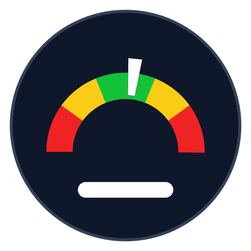
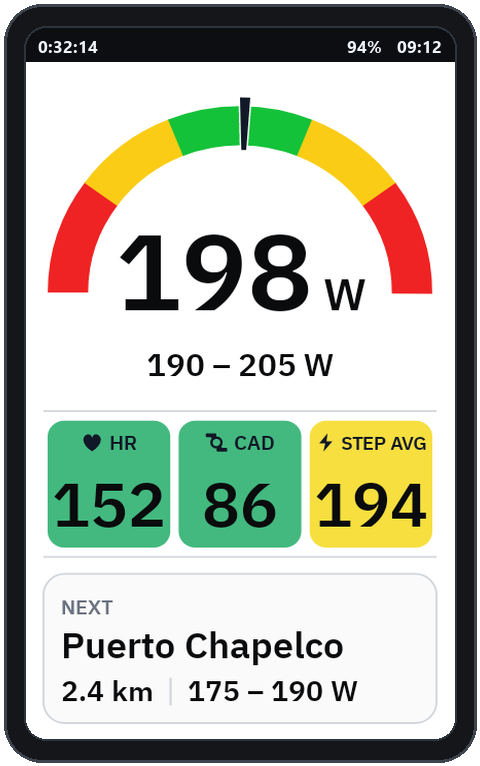
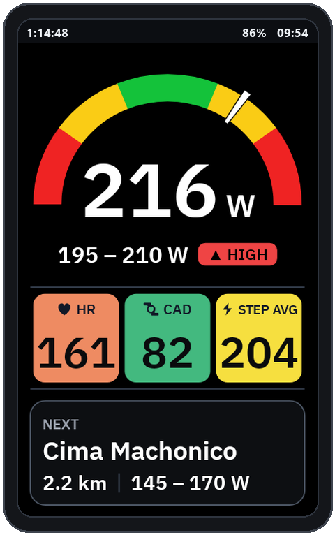
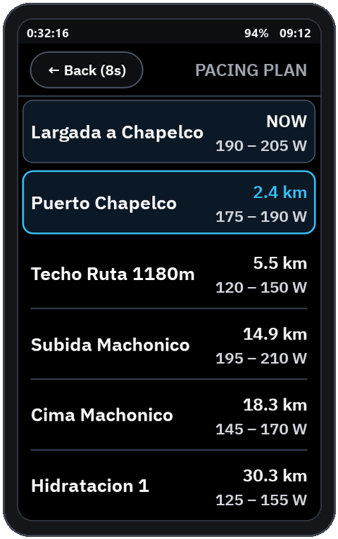
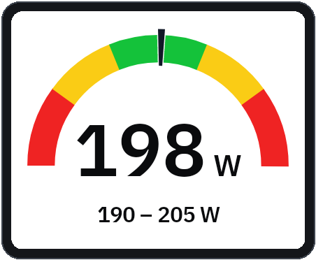

<p align="center">
  
</p>

<h1 align="center">Karoo GF Companion</h1>

<p align="center">
  <strong>Glanceable, route-driven power pacing for Hammerhead Karoo 3.</strong><br/>
  Turn your route waypoints into a live Gran Fondo power guide with a semicircular gauge, Karoo-native zone tiles, and next-checkpoint navigation.
</p>

<p align="center">
  
  &nbsp;&nbsp;
  
  &nbsp;&nbsp;
  
</p>

---

## Why Karoo GF Companion?

Pacing a Gran Fondo or long mountain event by watts is much easier when your Karoo tells you **the exact target for the climb or valley you are riding right now**—without juggling workout files or memorizing cue sheets.

Embed your target watts directly in your route's waypoint names, load the route on your Karoo 3, and ride by the needle.

---

## Key Features

- **Semicircular Power Gauge** — Instant 5-zone visual feedback (red / yellow / green target / yellow / red) with a high-contrast needle, large live power (`1s`, `3s`, `5s`, or `10s` smoothing), active target range, and clear `LOW` / `HIGH` badges.
- **Karoo-Style Supporting Metrics** — Large, unitless **HR**, **Cadence**, and **Step Avg Power** tiles with crisp icons and **optional zone-colored backgrounds**:
  - **HR & Step Avg** automatically read your 5- or 7-zone profile directly from Karoo OS and use Hammerhead's standard zone colors.
  - **Cadence** uses a 3-color guidance band (**80–95 rpm green**, **70–79 / 96–105 rpm yellow**, **< 70 / > 105 rpm red**, neutral at `0 rpm`).
- **Route-Driven Power Segments** — Automatically reads targets from active route POIs while keeping ordinary checkpoints (water, aid stations, summits) intact—no fabricated waypoints.
- **Next Checkpoint + CueSheet+ Integration** — Always see the next point ahead, remaining distance, and upcoming power target. Tap the **NEXT** card to jump straight into **Karoo Cue Sheet+** (detail & ETA) or open the built-in **Pacing Plan** overlay.
- **Segment Transition Alerts** — Optional double-beep tone and/or in-ride banner when entering a new power segment.
- **Adaptive Layouts & Themes** — Works in Full Field (1-field page), Half Field (2-field page), Wide, and Compact slots, with automatic Karoo **Day / Night** switching and **English, Spanish, and Portuguese** localization.

<p align="center">
  
</p>

---

## How to Format Route Waypoints

Add your target power range in parentheses to any route waypoint name (in RideWithGPS, Hammerhead Dashboard, Strava, or GPX):

```text
Largada a Chapelco (190-205W)
Puerto Chapelco (175-190W)
Techo Ruta 1180m (120-150W)
Hidratacion 1                  ← ordinary waypoint (no power change, still shown in NEXT)
Subida Machonico (200W)        ← single-value target (uses configurable ±W tolerance)
```

When you pass a waypoint with a power target, it becomes your active segment and **Step Avg** automatically resets for that segment.

---

## Installation on Hammerhead Karoo 3

### Option 1: Hammerhead Companion App / Karoo Extensions (Recommended)
1. Download the latest `KarooGFCompanion-v1.0.0-release.apk` from [GitHub Releases](https://github.com/apopovsky/KarooGFCompanion/releases/latest) (or install via the Extensions manifest URL).
2. On your Karoo 3, go to **Profiles → Pages → Add Field → Karoo GF Companion → GF Pacing Guide**.
3. Place it in a **1-field (full screen)** or **2-field (half screen)** layout.

### Option 2: Install via ADB
```powershell
adb install -r KarooGFCompanion-v1.0.0-release.apk
```

---

## Build & Development

Requires **JDK 17**, an **Android SDK**, and GitHub Packages credentials (`gpr.user` / `gpr.key` or `USERNAME` / `TOKEN`) for `io.hammerhead:karoo-ext`.

```powershell
# Run unit tests and assemble debug APK
.\gradlew.bat :shared:testDebugUnitTest :app:assembleDebug

# Install debug build on a connected Karoo 3
adb install -r app\build\outputs\apk\debug\KarooGFCompanion-v1.0.0-debug.apk

# Build & run local simulator (requires sibling ../KarooExtensionSimulator)
.\gradlew.bat :simulator:assembleDebug
.\run_simulator.cmd
```
